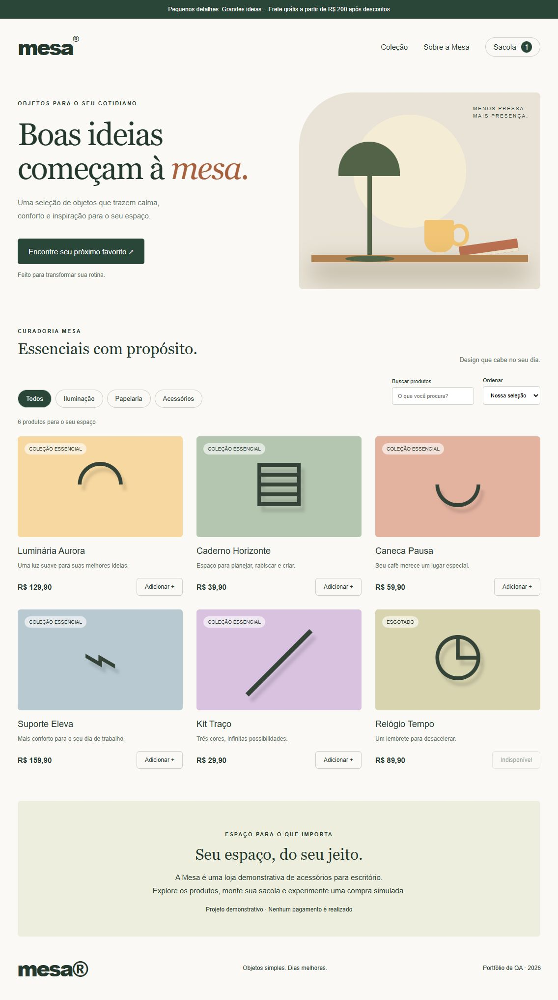

# Mesa | Portfólio de QA

Neste projeto, reúno a documentação de casos de teste e a automação com **Cypress e JavaScript** para uma loja virtual demonstrativa. O objetivo é validar a busca de produtos, o carrinho, os descontos e a finalização de pedidos.

**Responsável:** [Nadine Amaral — @nadii91](https://github.com/nadii91)



## Escopo dos testes

- Catálogo, busca, filtro e ordenação de produtos.
- Inclusão, remoção e persistência de itens no carrinho.
- Aplicação de cupons e cálculo do total.
- Compra simulada e validação de dados na API.

## Documentação

- [Casos de teste: cenários, passos e resultados esperados](docs/casos-de-teste.md)
- [Resultados das execuções](docs/resultados.md)
- [Modelo de registro de defeito](docs/bug-template.md)

## Execução local

Requisito: Node.js 24 LTS.

```sh
npm ci
npm start
```

A loja fica disponível em http://127.0.0.1:3000 enquanto o servidor estiver em execução.

## Testes automatizados

```sh
npm test
```

Modo interativo:

```sh
npm run test:open
```

Os comandos iniciam o servidor de testes na porta 3001. A execução automática também ocorre no [GitHub Actions](https://github.com/nadii91/mesa-qa/actions) a cada push ou pull request.

| Arquivo | Cobertura |
|---|---|
| `cypress/e2e/loja.cy.js` | 12 cenários de interface |
| `cypress/e2e/api.cy.js` | 6 cenários de API |
| `public/` e `server.js` | Aplicação utilizada nos testes |

## Regras e limites da aplicação

O cupom `MESA10` concede 10% de desconto. O frete custa R$ 15,90 e é gratuito a partir de R$ 200 após o desconto. Os dados dos testes são fictícios.

A loja não realiza pagamentos ou entregas. Não há login ou banco de dados; os pedidos não são armazenados e o estoque é fixo. A cobertura atual não inclui testes de carga, segurança ou uma auditoria completa de acessibilidade.
